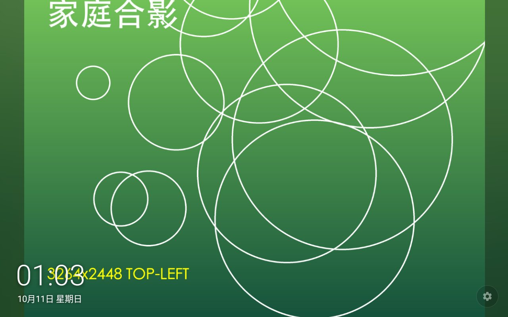
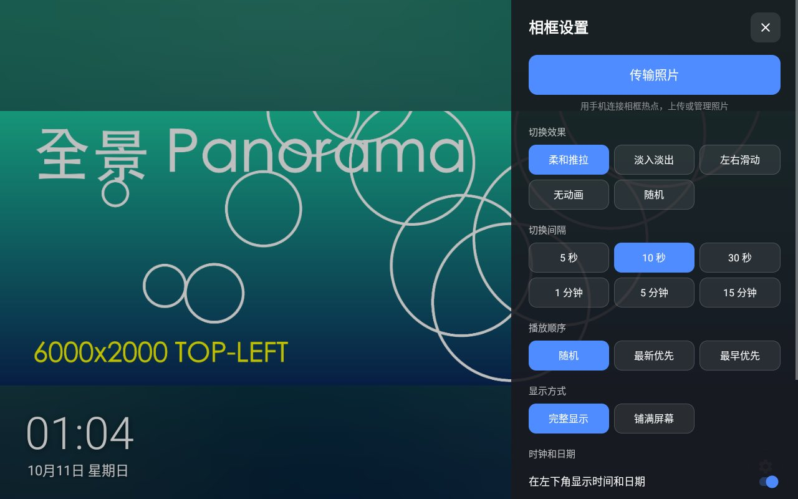
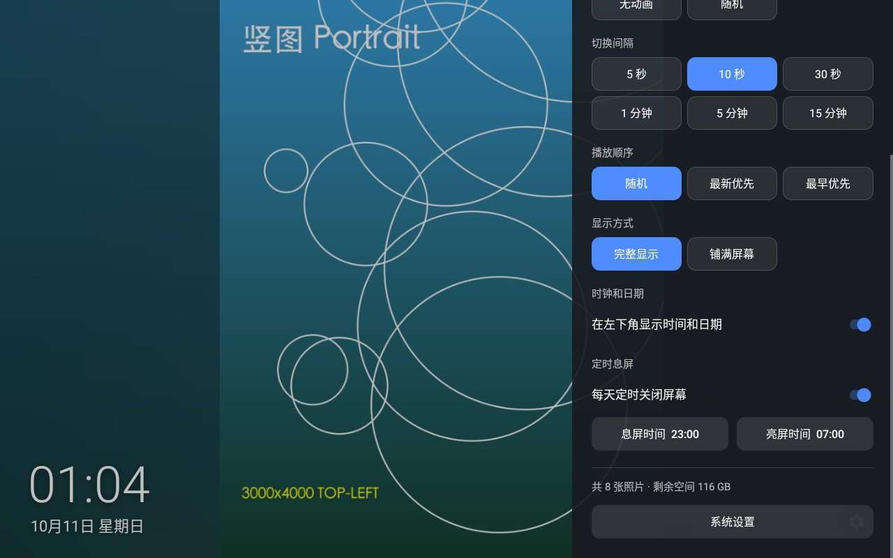
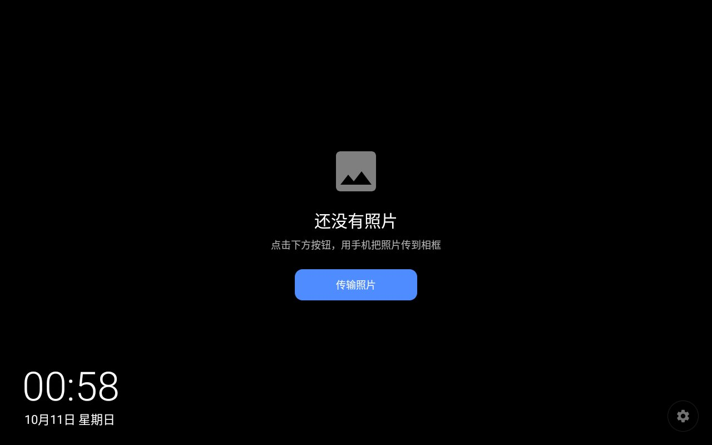
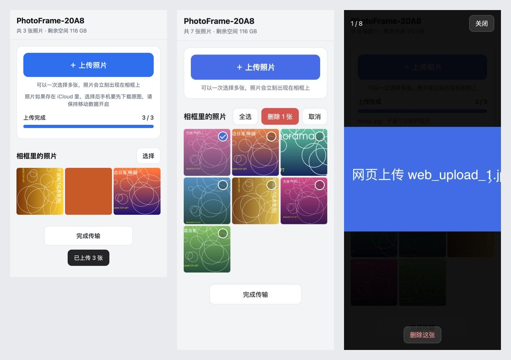

# Simple-PhotoFrame

**English** | [简体中文](README.zh-CN.md)

**Turn your Android tablet into a digital photo frame your grandparents will love.** No internet and no account needed: the frame opens its own Wi‑Fi hotspot, and family members upload photos by scanning a QR code with their phone.



## Why

- **Nothing to learn**: the tablet boots straight into the slideshow. There are no albums or folders to set up, and the Home button always leads back to the frame.
- **Works without internet**: fully offline, with no cloud service and no account.
- **Easy for the family**: scan two QR codes with a phone to upload, browse or delete photos. Nothing needs to be installed on the phone.

## Features

- **Boots into the frame**: registered as the home screen (launcher). The default effect is a gentle Ken Burns zoom, and photos that don't match the screen's aspect ratio get a blurred backdrop instead of black bars.
- **Slideshow settings** (tap the translucent ⚙ button in the bottom-right corner)
  - Effect: Ken Burns, crossfade, slide, none or random
  - Interval: 5 seconds to 15 minutes
  - Order: random, newest first or oldest first
  - Display: fit with blurred backdrop, or fill the screen
  - Swipe left or right to change photos by hand
- **Clock and date** in the bottom-left corner, can be turned off.
- **Scheduled screen off / on**, for example off at 23:00 and on at 07:00. If someone wakes the frame at night, it goes back to sleep after 5 idle minutes.
- **Always back to the frame**: every 5 minutes it checks whether something else (such as system settings) is covering the frame, and brings the frame back. It never wakes a screen that is off, and anyone who has just left the frame gets at least 3 minutes.
- **Upload from a phone**: the frame opens a **password-less hotspot** and shows a Wi‑Fi QR code plus a web page QR code.
  - The web page supports multi-photo upload with progress, a full-size photo viewer and batch delete
  - HEIC photos are converted to JPEG, keeping the capture date and correct orientation
  - Re-uploading the same photo is skipped automatically
  - The transfer ends after 20 idle minutes, or when you tap "完成" (Done) on the page or the frame
- **No permissions needed**: photos are stored in the app's own folder.

> The app's user interface is currently in Simplified Chinese.

## Screenshots

| Settings panel | Scheduled sleep |
|---|---|
|  |  |

| First start | Upload QR code on the frame |
|---|---|
|  |  |

The phone page (upload, select to delete, photo viewer):



## How to upload photos

1. Tap ⚙ in the bottom-right corner of the frame, then tap "**传输照片**" (Transfer photos).
2. Scan the left QR code with the phone camera to join the Wi‑Fi `PhotoFrame-XXXX` (no password).
3. Scan the right QR code to open the upload page, tap "上传照片" (Upload photos) and pick your photos.
4. When you're done, tap "完成传输" (Finish transfer) at the bottom of the page, or "完成" (Done) on the frame. The frame turns the hotspot off and goes back to the slideshow.

> - If your iPhone keeps photos in iCloud ("Optimize iPhone Storage"), the phone must download the originals after you pick them, so keep mobile data on.
> - Some phones prefer mobile data when the Wi‑Fi has no internet. If the page doesn't open, try turning mobile data off for a moment.

## Download

Get the latest APK from [Releases](https://github.com/czwstc/Simple-PhotoFrame/releases/latest), install it on the tablet and set it as the home app (see below).

> Release builds and your own debug builds are signed differently, so one can't be installed over the other: uninstall the old version first, which also removes the photos on the frame.

## Installation

### Build

Requires JDK 17 and the Android SDK (platform 34, build-tools 34):

```bash
./gradlew :app:assembleDebug
```

The APK ends up in `app/build/outputs/apk/debug/Simple-PhotoFrame-1.0.0-debug.apk`. For release signing, see `keystore.properties_sample`.

### Install and set as home app

```bash
adb install -r app/build/outputs/apk/debug/Simple-PhotoFrame-1.0.0-debug.apk
```

```bash
adb shell cmd package set-home-activity com.zweichen.photoframe/.frame.FrameActivity
```

You can also pick "Simple-PhotoFrame" under system Settings → Apps → Default apps → Home app.

### Device requirements

- Android 8.0 (API 26) or later; a landscape tablet works best.
- **Root is recommended** (many tablets and dev boards ship factory firmware with `su`). With root the frame can open a password-less hotspot, really turn the screen off and reliably return to the front.
- Without root it still works: the hotspot falls back to the system's local-only hotspot (random SSID and password, included in the Wi‑Fi QR code), and scheduled sleep shows a black screen at minimum brightness instead.
- Tested on an RK3566 tablet with Android 11 and a 1280×800 screen.

## How it works

- **Photo folder**: `Android/data/com.zweichen.photoframe/files/photos`.
- **Hotspot**: with root, the frame runs a small helper through `app_process` as root that asks the system Wi‑Fi service for an open hotspot. This gives an exact SSID, no 10-minute auto shutdown, and the factory MAC address. If that fails it falls back to `cmd wifi start-softap`, and the QR code always uses the SSID actually on air.
- **Wi‑Fi recovery**: chips without STA+AP concurrency drop the regular Wi‑Fi connection during a transfer and reconnect afterwards.
- **Upload server**: NanoHTTPD on port 8080. The web page is a single HTML file with no CDN dependencies.
  - `PUT /api/upload?name=` uploads one photo; the request body is the raw file
  - `GET /api/photos` lists photos, `GET /api/thumb/<name>` returns a thumbnail, `GET /api/photo/<name>` returns the original
  - `POST /api/delete` deletes photos, with body `{"names": [...]}`
  - `POST /api/finish` ends the transfer
- **Diagnostic log**: requests, upload results and events from the phone page are written to `files/transfer.log`, which helps when a particular phone can't upload.

## Debugging

Debug builds accept two switches that are ignored in release builds. Serve on the current network without opening a hotspot:

```bash
adb shell "su 0 am start -n com.zweichen.photoframe/.transfer.TransferActivity --ez skip_hotspot true"
```

End the transfer after 90 idle seconds instead of 20 minutes:

```bash
adb shell "su 0 am start -n com.zweichen.photoframe/.transfer.TransferActivity --ei idle_timeout_sec 90"
```

Read the transfer log:

```bash
adb shell run-as com.zweichen.photoframe cat files/transfer.log
```

## License

Simple-PhotoFrame is based on [Simple Gallery](https://github.com/SimpleMobileTools/Simple-Gallery) and is licensed under [GPL-3.0](LICENSE).
